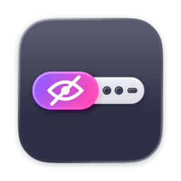
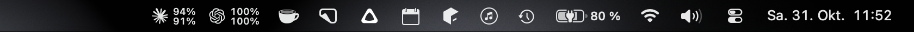
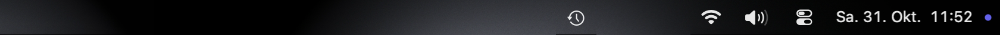
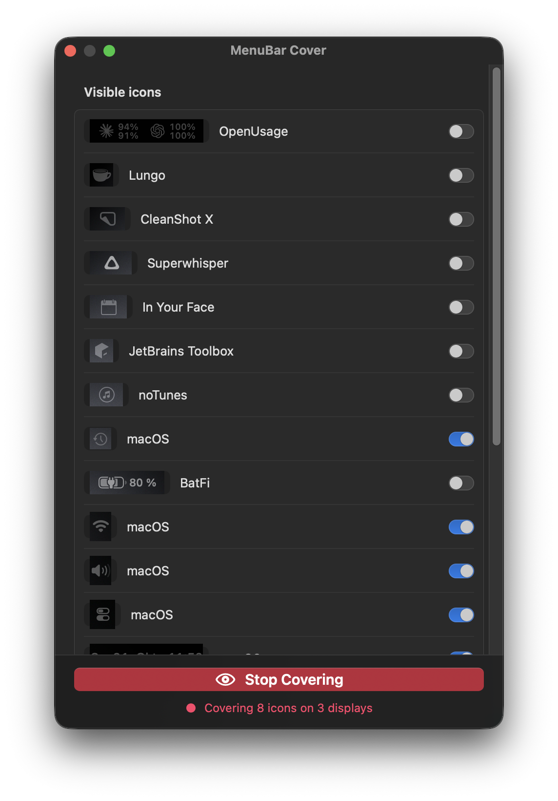

<div align="center">



# MenuBar Cover

**Hide menu bar icons on the screens you record**

[](https://github.com/peter-neumann-dev/menubar-cover/releases)
[](#-installation)
[](#-installation)
[](LICENSE)

[](https://github.com/peter-neumann-dev/menubar-cover)
[](https://github.com/peter-neumann-dev/menubar-cover/issues)

</div>

## 🚀 What it does

Screen recordings of QA sessions or demos show everything in your menu bar, such as usage meters
or chat apps. MenuBar Cover hides those icons while you record and leaves Apple's icons and the
clock in place.

The icons stay in the menu bar. MenuBar Cover places small panels over the ones you pick and fills
them with the matching slice of your wallpaper, so the recording shows an empty bar where the icons
were. Screens you didn't select stay as they are.

**Before**



**After**



## ✨ Features

- Pick which icons stay visible. Apple's icons and the clock are visible by default, everything
  else is covered
- Cover all screens or only the ones you select. Each screen is remembered, so this works with
  different monitors at home and at the office
- The covers follow icons that move or change width, such as live usage meters
- Recording indicators that macOS adds during a capture stay fully visible
- Screens showing a full-screen app are left alone
- One large button turns covering on and off
- Optional start at login, running in the background without a Dock or menu bar icon

<div align="center">



</div>

## 🔥 Installation

> [!IMPORTANT]
> MenuBar Cover is only tested on macOS 27 and only runs on Macs with Apple Silicon.

### Download

1. Download the zip file from the [latest release](https://github.com/peter-neumann-dev/menubar-cover/releases/latest)
2. Unzip it and move `MenuBar Cover.app` to your Applications folder
3. Open the app. Apple hasn't notarized the download, so macOS blocks the first launch. Go to
   System Settings > Privacy & Security, scroll down and click "Open Anyway"
4. Grant the permissions listed below

The release build has no developer certificate, so macOS asks for the permissions again after
each update.

### Build from source

Building needs Xcode 26 or later, which compiles the Icon Composer app icon.

```bash
git clone https://github.com/peter-neumann-dev/menubar-cover.git
cd menubar-cover
./build.sh --install
```

`build.sh` builds a release version, signs it with the first Apple Development or Developer ID
certificate in your keychain (ad-hoc if there is none), copies it to `~/Applications` and
launches it. With a real certificate the permissions below survive rebuilds.

`./build.sh --release` builds the ad-hoc signed zip file for a GitHub release.

### Permissions

On first launch, grant both permissions in the settings window:

| Permission       | Why                                                              |
| ---------------- | ---------------------------------------------------------------- |
| Accessibility    | Reads the positions of the menu bar icons                        |
| Screen Recording | Reads the wallpaper behind the menu bar to match its background |

## ⚙️ How it works

- Icon positions come from the Accessibility API (`AXExtrasMenuBar` of every running app). On
  current macOS versions menu bar icons are no longer separate windows, so this is the reliable
  source
- Every menu bar shows the same icons aligned to its right edge. The app stores positions as
  offsets from that edge and applies them to each selected screen
- The app merges neighbouring hidden icons into one panel. The panels use the window level right
  above the menu bar, so menus that open from the visible icons still appear on top
- The panel background is a ScreenCaptureKit capture of the wallpaper and the system's menu bar
  shading for that screen. The app refreshes it every 15 seconds and when you switch spaces

Run the tests for the layout logic with:

```bash
swift test
```

## ⚠️ Limitations

- Covered icons don't react to clicks while covering is on
- A newly appearing icon can show for a moment before it gets covered
- When you reveal the menu bar inside a full-screen app, the app covers nothing there
- Apple's icons don't expose names, so the settings list shows them as "macOS" with a live preview

## 👥 Contributing

Open an [issue](https://github.com/peter-neumann-dev/menubar-cover/issues) for bugs and ideas.
Pull requests are welcome.

## ⭐ License

This project is licensed under the terms of the [MIT license](LICENSE)
